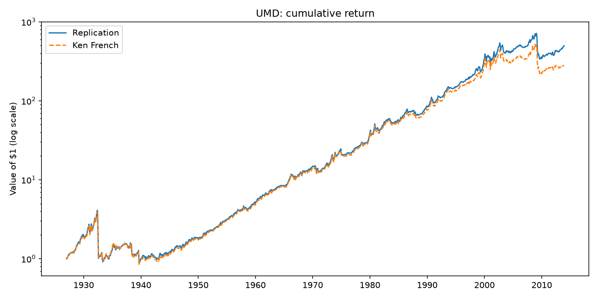

# AQR Momentum (UMD) Replication

Replication of the UMD (Up Minus Down) momentum factor used in
Asness, Frazzini, Israel and Moskowitz (2014), *"Fact, Fiction and Momentum Investing"*,
*Journal of Portfolio Management*. The factor is built from raw CRSP data and validated
against the official series in Kenneth French's Data Library.

First paper of the CUNEF Quantitative Finance Club reading group.

## Results (Jan 1927 – Dec 2013, 1,044 months)

| | Annual mean | Annual volatility | Sharpe ratio |
|---|---|---|---|
| This replication | 8.71% | 16.33% | 0.53 |
| Kenneth French UMD | 8.07% | 16.59% | 0.49 |

**Monthly correlation with the official series: 0.993.**



The two series move almost identically for seven decades. The small gap that opens in
2000–2002 and in the 2009 momentum crash, when extreme past losers rebounded sharply,
most likely comes from differences in the stock universe rather than in the method:
share-type filters, the handling of missing returns in the formation window, and the
CRSP vintage (French's series uses a more recent revision of the database).

## Data

- CRSP monthly stock file (Fama-French style), Dec 1925 – Dec 2013, accessed through WRDS.
  NYSE, AMEX and NASDAQ stocks.
- Official UMD: `F-F_Momentum_Factor.CSV` from the
  [Kenneth French Data Library](https://mba.tuck.dartmouth.edu/pages/faculty/ken.french/data_library.html).

CRSP data are not included in this repository because of WRDS licensing.

## Method

1. **Signal:** cumulative return from month t-12 to t-2, skipping the most recent month (t-1).
   All 11 monthly returns are required.
2. **Size:** previous month's market capitalisation, split at the NYSE median.
3. **Momentum:** 30th and 70th NYSE percentiles of the signal, the same breakpoints for
   small and big stocks (independent sorts, as in French).
4. **Portfolios:** value-weighted by previous month's market capitalisation, rebalanced monthly.

UMD = 1/2 (Small Winners + Big Winners) − 1/2 (Small Losers + Big Losers)

Annualised mean = monthly mean × 12; annualised volatility = monthly std × √12.
UMD is a zero-cost long-short portfolio, so the Sharpe ratio is computed without subtracting
the risk-free rate.

## How to run

Place the CRSP extract and `F-F_Momentum_Factor.CSV` in the same folder as the script and run:

```
python umd_replication.py
```

Requires `pandas`, `matplotlib`. Outputs:

- `umd_monthly.csv`: monthly UMD series.
- `umd_cumulative.png`: cumulative return chart against French's series.
- Summary statistics and correlation, printed to the console.

## Notes on AI assistance

The core pipeline (signal construction, size and momentum sorts, portfolio
weighting and the UMD series) was written by me.

Claude (Anthropic) was used to:

- write the duplicate-removal step;
- review the method, which led to switching to French's size-independent
  momentum breakpoints;
- write the validation against French's series (statistics, correlation and chart);
- draft this README.

It was also used throughout for debugging, code clean-up and spotting potential
errors in my code, such as the handling of missing values.

Every change was reviewed and run by me on the full CRSP sample.
